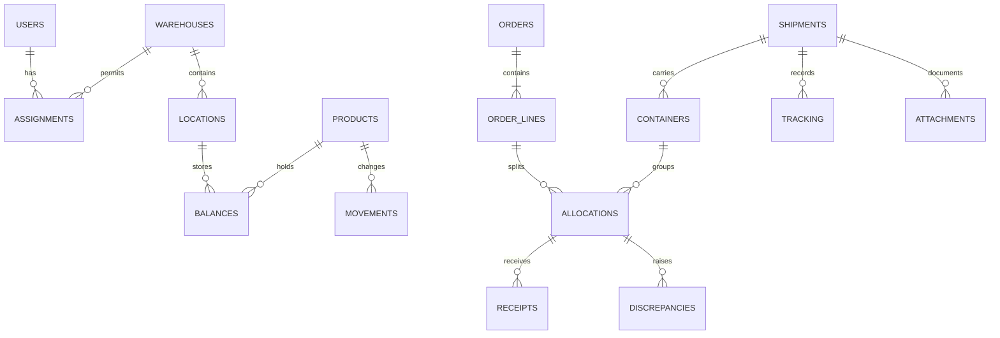

# Architecture

Next.js App Router renders authenticated pages on the server. Small client components manage dialogs, form feedback, navigation and selection of the dashboard shipment. Route handlers enforce sessions, request origin and CSRF before dispatching to the domain layer. Database rows are converted to ordinary objects before crossing the React Server Component boundary.

## Modules

| Module | Responsibility |
| --- | --- |
| `lib/db.ts` | SQLite schema version 1, migrations, transactions, permission helpers, fixed-point parsing and audit |
| `lib/operations.ts` | Validated business operations, ledger posting and idempotency |
| `lib/queries.ts` | Warehouse-scoped queries, pagination, reports, progress and alerts |
| `lib/auth.ts` | Password hashing, sessions, local resets, TOTP and user administration |
| `lib/documents.ts` | File signature validation and download authorization |
| `app/api` | HTTP request boundaries and private downloads |
| `components` | Accessible form dialogs, navigation and responsive cargo visualization |

## Entity relationships

Additional entities cover conversions, lots, thresholds, count approvals, transfers, import batches, sessions, reset tokens, rate-limit windows, ETA revisions, idempotency records and immutable audit events. Reservations and cargo lines are represented by allocation records with separately accounted state quantities; receipt sessions are immutable receipt postings rather than a second aggregate status table.

## Inventory transaction model

All quantities are safe integer micro-units, up to six decimal places. A product's precision controls permitted inputs. Unit conversion uses integer arithmetic and rejects nonrepresentable results. Weight and volume are independent measurements.

`OnHand = Available + Reserved + Staged + Loaded + Blocked`

`Available` is its own balance, never a subtraction of overlapping buckets. Reserve, stage, load and inspection each post a negative source movement and a positive destination movement in the same transaction. Dispatch removes Loaded from on-hand. Physical receipt adds Available or Blocked. Inter-warehouse transfer removes source on-hand into an explicit In Transit transfer; destination receipt posts it once. Dispatched cargo remains in allocations outside warehouse balances.

Each mutation uses `BEGIN IMMEDIATE`. SQLite serializes writers across database connections, including separate processes. Conditional balance updates reject underflow. Domain validation, stock updates, movement inserts, audit records and the operation result commit together or roll back together. A unique operation key binds actor and payload digest; exact retries return the prior result, while changed payloads conflict.

Count approval checks the counted balance version. Container and allocation changes increment shipment versions so a stale dispatch review conflicts. Ledger and audit triggers reject UPDATE and DELETE. Reversals link to original movements; dispatch correction does not stand in for a physical cargo return.

## Read model

Queries enforce warehouse scope before pagination (25 records). Exports reuse query definitions and support up to 100,000 filtered records. Employee file metadata also excludes manager-only documents. Form lookup lists are capped at 10,000 products and 1,000 recent order lines/shipments; larger deployments should add typeahead endpoints.

Order quantity progress is derived from allocation postings. Transport state is derived from active checkpoint records, with the highest confirmed progression retained despite late-arriving older events. Corrections preserve original records through supersession links. Shipment and container event scopes remain distinct. Outbound operational fulfilment currently means dispatch; inbound fulfilment means receipt plus approved residual closure and required discrepancy resolution. This is not last-mile delivery confirmation.

## Storage and recovery

SQLite uses WAL, foreign keys and a busy timeout. Back up a consistent database snapshot and private files together. Keep the MFA encryption key in secret storage separate from code and backups. Verify restoration in an isolated folder and reconcile balances before a pilot. Horizontal deployment requires replacing and retesting the transaction layer on PostgreSQL.
